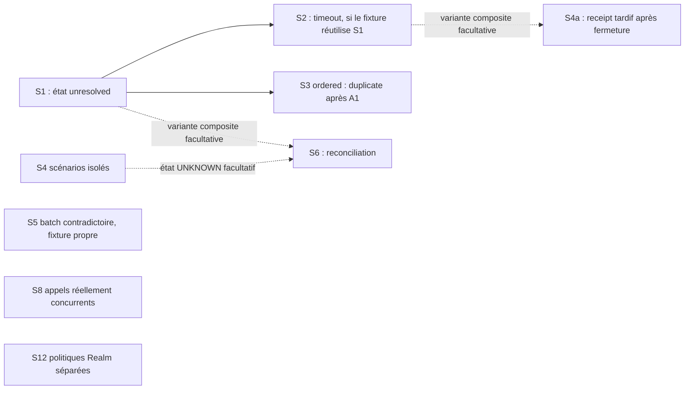
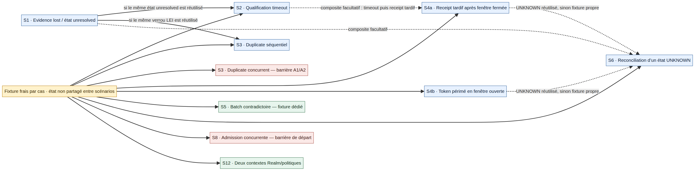

# Réutiliser le harness S1-G1 dans la conformance REG client

**Statut : proposition d’intégration, pas une nouvelle revendication de preuve.** Le dépôt `tenir-conformance-s1-g1` contient déjà des définitions opérationnelles et des tests de la membrane de laboratoire. Ils sont utiles pour construire des scénarios adversariaux client, mais les tests actuels ne s’exécutent pas automatiquement contre une implémentation tierce.

## Ce qui est réutilisable

- Les scénarios en langage humain, leurs préconditions, sous-cas, assertions négatives, événements attendus et critères d’évidence.
- Les fixtures à horloge contrôlée, les transitions sérialisées en JSONL, les snapshots d’état, le registre de permits et l’`effect_sink` quand ces interfaces sont substituées par un adapter du client.
- Les cas de non-régression gardés : perte d’évidence, τ_K, duplicate request, receipt périmé, preuve contradictoire, reconciliation, admission concurrente et divergences inter-realm.
- Le commit source, le manifeste, les identifiants de runs CI et les hashes comme provenance du scénario et de son résultat de référence.

La réutilisation correcte consiste à conserver le **scénario et l’oracle**, puis à ajouter un driver/adaptateur traduisant ses commandes vers l’interface observable du client. Il ne faut pas importer la membrane de laboratoire en remplacement du système sous test, ni recopier les tests en remplaçant leurs attentes par le comportement observé.

## Ce que le harness établit aujourd’hui

Le statut courant déclare des PASS empiriques des définitions G0 S1–S6 contre la membrane de laboratoire, pour les interleavings séquentiels testés, avec des artefacts CI. Il signale explicitement que cela ne prouve ni sécurité sous concurrence asynchrone sans borne, ni cryptographie de production, ni conformance/certification d’une gateway. S8 est un test borné à deux threads dans un processus; il ne vaut pas une preuve distribuée. Les résultats de ce dépôt doivent apparaître dans le rapport client sous `LAB_REFERENCE`, jamais être fusionnés avec `CLIENT_ADAPTER` ou `CLIENT_NATIVE`.

La charge S1 utilise le `tenir_governance.PolicyEngine` réel pour le score, mais toujours dans la membrane de laboratoire et pour le périmètre déclaré. Les attestations de non-exécution sont déclaratives pour l’upstream; elles ne deviennent pas une preuve cryptographique parce que le runner les a lues.

## Dépendances et ordre d’exécution

Le harness n’exige pas de lancer toute la série S1 à S6 dans cet ordre. Les dépendances sont des états de scénario et des étapes causales, pas une séquence de pipeline globale. Un fixture peut créer directement l’état initial attendu, à condition de rendre cet état explicite et d’en enregistrer la preuve; ainsi un run CI peut distribuer des scénarios indépendants sans consommer l’artefact d’un job précédent.

| Cas | Précondition / dépendance déclarée | Ordre interne | Ordonnancement inter-cas recommandé |
|---|---|---|---|
| S1 — Evidence Lost After Commit | Aucun précurseur nécessaire; le fixture choisit la vérité du target pour S1a/b/c. | Issue/effet ou perte → reçu absent → retry bloqué. Post-reconciliation T7/T8 est un test séparé selon la définition S1. | Parallèle aux cas indépendants avec Realm/LEI/sink dédiés. |
| S2 — Qualification Timeout | `G0_S2` déclare une dépendance au verrou LEI unresolved de S1; elle peut être satisfaite par un fixture équivalent. | Admission/permit consommé → attente/horloge > τ_K → UNKNOWN/HOLD → retry sans reconciliation bloqué. | Séquentiel dans chaque scénario; pas besoin d’attendre la fin du job S1 si l’état est reproduit. |
| S3 — Duplicate Request | S1 unresolved LEI lock; la définition autorise soumission A2 « concurrent or subsequent »; T7/T8 forment le chemin de retry terminal distinct. | A1 en attente/UNKNOWN → A2 même LEI; sous-cas S3d vérifie l’unicité attempt_id. | Publier deux résultats distincts : `ordered_duplicate` et `concurrent_duplicate`. Le premier est sériel; le second nécessite barrière/synchronisation. |
| S4 — Stale Receipt | Pas de dépendance globale à S2, mais S4a peut consommer un état UNKNOWN/window-closed produit par τ_K; S4b a un attempt en cours et token expiré. | Créer état → fermer la fenêtre ou expirer token → présenter receipt → vérifier rejet sans effet/permit. | Sous-cas isolés; ne pas confondre `deliver_receipt` avec l’API `reconcile` de S6. |
| S5 — Contradictory Evidence | Préparer un attempt non terminal pour S5a ou un attempt terminal pour S5b. | Soumettre batch complet, lié, contradictoire → évaluation atomique → escalade/quarantaine et zéro nouvel effet. | Parallèle seulement avec état Realm/LEI/évidence indépendant. |
| S6 — Successful Reconciliation | État initial UNKNOWN; peut être la suite d’un S1/S2/S4 composite ou créé directement par fixture. | Réconciliation → état de sortie qualifié; aucune émission d’effet/permit pendant l’observation. | Ordonné dans le scénario; une chaîne `S1 → S6` est un composite optionnel, non une dépendance de toute la suite. |
| S8 — Concurrent Admission | État clean; appels synchronisés pour contester un LEI ou contrôle avec LEI distincts. | Opérations concurrentes par conception avec barrière; vérifier le nombre d’admissions/permits/effets. | Parallèle interne obligatoire. Garder l’étiquette « deux threads/process-local » exacte. |
| S12 — Cross-Realm | Deux politiques Realm signées séparées et même Realm ID/transition/payload. | Charger les politiques puis comparer verdicts. | Indépendant de S1–S6; deux contextes doivent rester séparés. |

### DAG de la suite candidate





Diagramme complet : [source Mermaid](diagrams/REG_TENIR_Scenario_Dependencies.mmd) · [rendu PNG](diagrams/REG_TENIR_Scenario_Dependencies.png).

Les flèches pointillées désignent une option de composition de tests, pas une exigence d’exécuter le job précédent. À défaut d’un état partagé explicitement défini, le scénario doit reconstruire son propre pré-état. S8 ne doit pas être « sérialisé » : sa simultanéité est le stimulus évalué. Les 100 répétitions S8a et le contrôle S8b/S8c doivent rester décrits comme expériences bornées, pas comme une preuve générale.

## Contrat d’adapter candidat

Les opérations ci-dessous sont une proposition d’interface pour rendre les scénarios indépendants du framework client. Elles ne constituent pas encore un contrat ratifié, et la suite publique `reg-conformance` n’offre pas encore ce plugin universel.

```text
fixture.create(profile, scenario_id, namespace) -> fixture_handle
client.submit(action, lei, attempt_id, nonce) -> observed_response
client.deliver_receipt(receipt) -> observed_response
client.reconcile(evidence_reference) -> observed_response
fixture.advance_clock(delta) -> timestamp
fixture.snapshot() -> state_snapshot
fixture.effect_sink_delta() -> integer
fixture.transition_trace() -> append_only_events
fixture.destroy() -> cleanup_result
```

Règles à figer avec l’interface :

- Le client peut être écrit dans n’importe quel langage, mais chaque observation doit être mappable vers les champs du scénario.
- Tous les IDs et espaces de noms sont uniques par run et par scénario, sauf le même LEI intentionnellement partagé par les concurrents d’un seul cas.
- Les tests de retry, de duplicate et de mutation n’ont accès qu’à un sandbox ou un sink synthétique; aucune opération ne doit viser un provider ou une donnée de production.
- Les cas de laboratoire et d’implémentation client ont des rapports/fingerprints distincts. Le résultat du lab sert au contrôle de l’oracle, non à remplacer l’exécution du client.
- Une adaptation qui ne peut pas exposer une observation requise donne `INCONCLUSIVE`/`ADAPTER_REQUIRED`, pas un PASS inféré.

## Relation aux autres documents

Ces liens sont un crosswalk documentaire, sans arêtes normatives nouvelles :

- **REG Core/RFC-4** fournit la sémantique et les obligations de transition retenues pour un vecteur donné; c’est l’oracle après que la version et l’applicabilité ont été approuvées.
- **REG+** fournit le profil/hypothèses de configuration et les contrôles d’admissibilité/évidence; structurellement admissible ne veut pas dire efficacité démontrée.
- **REG-ARCH** est une représentation architecturale illustrative (niveaux 0–4, fonctions `Evaluate()`, `Commit()`, `Record()` et `Assure()`); elle peut aider à tracer objets, responsabilités et dépendances candidates, mais ne remplace ni RFC, ni profil, ni test. La chaîne `Evaluate → Commit → Record` ne devient une dépendance d’un vecteur que si le contrat versionné testé l’exige et si l’adapter peut l’observer; elle n’impose pas l’ordre d’évaluation de Standing, Structure et Commit ni l’ordre global de la suite. La page publique qualifie l’architecture d’illustrative et non normative.
- **Ce dépôt** garde le statut de ses tests de membrane/lab; **`reg-conformance`** décide séparément comment un client est testé par un adapter et produit son rapport.

Voir [le modèle d’exécution du dépôt `reg-conformance`](https://github.com/skiredj-prog/reg-conformance/blob/main/docs/MODELE_EXECUTION_CONFORMANCE_CLIENT.md), [REG-ARCH](https://tenirlabs.cc/en/portfolio/reg-arch/), [architecture illustrative](https://tenirlabs.cc/en/architecture/), et [REG+ / RFC](https://tenirlabs.cc/portfolio/technical/).

## Gates proposées pour une PR d’intégration

1. **G0 — Crosswalk accepté :** scénario, version RFC, profil et statut de preuve liés explicitement.
2. **G1 — Adapter purement translationnel :** même scénario, mêmes assertions; l’adapter ne choisit ni verdict attendu ni état de succès.
3. **G2 — Fixture isolé :** horloge, namespaces, traces et sink synthétiques contrôlés; teardown vérifiable.
4. **G3 — Dépendances déclarées :** chaque edge a une justification de causalité ou de partage d’état; l’ordonnanceur ne déduit rien de l’ordre lexical des tests.
5. **G4 — Concurrence explicitement testée :** seulement les scénarios qui nomment l’interleaving et les limites peuvent lancer plusieurs appels simultanés.
6. **G5 — Rapport scindé :** références lab, adapter client et preuve native demeurent des colonnes/sources séparées; une lacune de couverture bloque le verdict de profil.

## Sources

- [`STATUS.md`](../STATUS.md)
- [Définitions S1–S4](../G0_S1_Evidence_Lost_After_Commit.md), [S2](../G0_S2_Qualification_Timeout.md), [S3](../G0_S3_Duplicate_Request.md), [S4](../G0_S4_Stale_Receipt.md)
- [S5 contradiction](../scenarios/G0_S5_CONTRADICTORY_EVIDENCE.md), [S6 reconciliation](../scenarios/G0_S6_SUCCESSFUL_RECONCILIATION.md), [S8 concurrence](../scenarios/G0_S8_CONCURRENT_ADMISSION.md)
